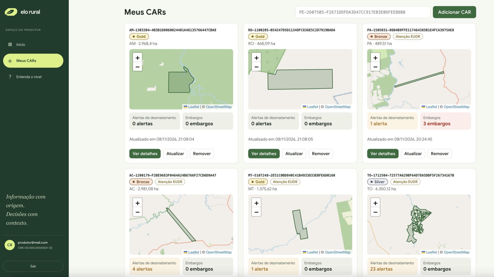
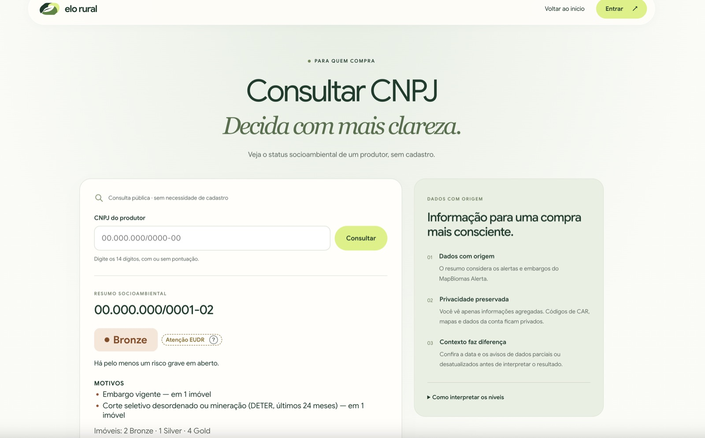

# Elo Rural

**Elo Rural** é uma plataforma que mostra, de forma simples e rastreável, a situação socioambiental de
produtores rurais brasileiros: **o polígono de cada imóvel (CAR), alertas de desmatamento, embargos e
indicadores socioambientais**, com dados públicos do **MapBiomas Alerta**, do **INPE** (PRODES, DETER,
Queimadas) e do **IBAMA** (áreas embargadas e SINAFLOR). Atende dois públicos:

- **Produtor rural** (com conta): cadastra seu CNPJ e seus CARs e acompanha cada imóvel em um painel.
- **Comprador** (sem conta): frigorífico, trading, cooperativa ou varejista que consulta o CNPJ de um
  fornecedor e vê um nível resumido (**Gold**, **Silver**, **Bronze** ou **Sem dados**).

*A página inicial do Elo Rural: o produtor entra no painel e o comprador consulta um CNPJ.*

---

## O problema

O mercado de commodities agropecuárias (soja, carne, café, cacau, madeira...) exige cada vez mais
comprovação de que a produção **não vem de áreas desmatadas ou embargadas**. Compromissos como a
Moratória da Soja, os TACs da Carne, as regras de crédito rural e regulações de importação como a
EUDR (União Europeia) transformaram a origem socioambiental em condição para vender.

As informações necessárias para essa verificação **existem e são públicas**, mas estão espalhadas,
são técnicas e difíceis de cruzar:

- alertas de desmatamento validados, em plataformas que exigem conhecimento técnico;
- embargos do IBAMA, do ICMBio e de órgãos estaduais, cada um com seu formato;
- o CAR (Cadastro Ambiental Rural), que liga um polígono a um imóvel, mas não diretamente a um CNPJ;
- bases abertas enormes, difíceis de baixar e de interpretar.

## As dores

### Do produtor

- **Não sabe como é visto pelo mercado.** Descobre um alerta ou embargo só quando a venda ou o
  crédito é bloqueado.
- **Não tem os dados reunidos.** Precisaria consultar várias plataformas, uma por imóvel, e
  interpretar mapas e processos técnicos.
- **Não consegue agir a tempo.** Sem saber quais alertas cruzam seu imóvel, quando foram detectados
  e qual área afetam, não consegue contestar, regularizar ou explicar.
- **Não tem como provar uma situação limpa.** Mesmo sem problemas, não tem um jeito simples de
  mostrar isso ao comprador.

### Do comprador

- **Due diligence cara e manual.** Verificar cada fornecedor exige analistas, ferramentas de mapas e
  acesso a várias bases.
- **Risco jurídico e de reputação.** Comprar de uma área embargada ou desmatada pode gerar multas,
  perda de mercado e danos à marca.
- **Informação pouco confiável.** Fontes externas caem ou ficam incompletas, e um "zero" pode
  significar "sem problemas" ou "não consegui consultar".
- **Precisa de uma resposta rápida.** Antes de fechar uma compra, quer saber em segundos se o
  fornecedor apresenta risco, sem precisar criar conta nem pedir dados ao produtor.

## A solução

Uma plataforma que **organiza por imóvel e por CNPJ** os dados ambientais que já são públicos e os
apresenta de forma clara para cada público.

### Para o produtor: o painel

- **Cadastro curto** (email, CNPJ e senha); depois o produtor adiciona seus CARs.
- **Início**: três números (imóveis, alertas em aberto e embargos vigentes) e o **relatório do CNPJ**:
  o nível do CNPJ, o sinal "Atenção EUDR", um resumo em linguagem simples e o nível e a situação de cada
  imóvel (ver [Onde usamos IA](#onde-usamos-ia)).
- **Meus CARs**: cada imóvel em um cartão com o mapa, o número de alertas de desmatamento e de embargos,
  e o nível do imóvel.
- **Detalhe de cada CAR**: os indicadores separados em *Riscos abertos* (o que pesa no nível) e
  *Contexto* (vegetação nativa, focos de calor, manejo florestal autorizado…), cada alerta com sua data,
  área e situação ("sem autorização registrada", "autorizada", "com embargo"…) e cada embargo com o órgão,
  o processo e a fonte do dado.
- **Entenda o nível**: uma página que explica, em linguagem simples, como o nível é calculado e o que
  fazer para melhorá-lo.

*"Meus CARs": cada imóvel com mapa, nível, alertas, embargos e o sinal "Atenção EUDR" (dados de exemplo).*

### Para o comprador: a consulta pública por CNPJ

O comprador digita um CNPJ, **sem cadastro**, e vê uma ficha resumida: o nível, quantos imóveis em cada
nível, os motivos e a data dos dados. Nunca vê códigos de CAR, mapas nem dados da conta do produtor.

*Consulta pública, sem cadastro: o nível do CNPJ e os motivos, só com dados agregados (CNPJ de exemplo).*

### Transparência para os dois lados

O produtor vê no seu painel **exatamente o mesmo nível** que o comprador vê, para saber como é percebido
e corrigir o que falta antes de uma venda.

## Como funciona o nível

| Nível | Significado |
|---|---|
| **Gold** | Nenhum risco em aberto. |
| **Silver** | Há riscos em aberto, mas nenhum grave (por exemplo, alertas sem autorização registrada), ou parte dos dados não pôde ser verificada. |
| **Bronze** | Há pelo menos um risco grave em aberto: embargo vigente, alerta em terra indígena ou unidade de conservação de proteção integral, desmatamento recente em reserva legal ou APP, ou corte seletivo desordenado e mineração na Amazônia. |
| **Sem dados** | Não foi possível obter os dados. |

- O nível do **CNPJ é o do imóvel em pior situação**, porque quem compra não sabe de qual imóvel vem o
  produto.
- O que já foi resolvido (alertas autorizadas, embargos levantados) e as informações de contexto **não
  rebaixam o nível**.
- O sinal **"Atenção EUDR"** aparece, separado do nível, quando há desmatamento detectado depois de
  31/12/2020, mesmo que autorizado.
- O nível é calculado por **regras fixas, iguais para todos**. Nenhuma inteligência artificial escolhe
  o nível.

As regras completas, com todos os critérios e limites, estão em
[`docs/proposta-regras-nivel.md`](docs/proposta-regras-nivel.md).

## Onde usamos IA

Só em um lugar: o **relatório do CNPJ**, no Início do produtor. A IA lê os dados que a plataforma já
calculou para cada imóvel e os transforma em um resumo fácil de entender: o que pesa no nível, o que é só
contexto e o que significam os termos técnicos.

- A IA **não decide o nível** nem calcula nada: o nível vem sempre das regras fixas.
- A IA **não recebe** os códigos dos imóveis, o CNPJ nem dados pessoais.
- Todo número citado é conferido com os dados; se algo não bate, o texto é descartado e o relatório é
  montado automaticamente por regras.
- O relatório indica sempre quem o escreveu ("Gerado por IA" ou "Gerado automaticamente por regras").

## Visão de futuro: o nível como porta de acesso a benefícios

Hoje o nível Gold/Silver/Bronze é um **indicador informativo**: ajuda o produtor a saber como é visto
e o comprador a avaliar um fornecedor. No futuro, ele **poderá ser usado para que o produtor obtenha
benefícios ou créditos**, por exemplo:

- condições melhores em linhas de **crédito rural** ou financiamentos verdes, junto a bancos e
  cooperativas de crédito;
- acesso preferencial ou **bonificações** em programas de compra de frigoríficos, tradings e
  cooperativas;
- comprovação simples da situação socioambiental exigida por mercados como o europeu (EUDR).

Isso dependeria de parcerias com instituições financeiras e compradores, e de um método de score
transparente. Até lá, o nível **não é uma certificação ambiental nem garante crédito**: é calculado por
regras fixas a partir de dados públicos e pode mudar quando as fontes são atualizadas.

## Nossos princípios

- **Privacidade por agregação:** o comprador vê só dados agregados por CNPJ (nível, contagens, datas).
  Códigos de CAR, mapas, dados da conta e dados pessoais de terceiros continuam privados.
- **Honestidade nos dados:** "0" significa dado confirmado. Quando uma fonte não responde, a plataforma
  mostra "indisponível" ou os últimos dados salvos, marcados como desatualizados. Nunca um zero falso.
- **Fidelidade à fonte:** mapas, alertas e embargos aparecem como a fonte os entrega, e todo dado
  calculado indica em que se baseia e a data.
- **Linguagem responsável:** uma alerta sem autorização registrada não é chamada de "ilegal"; o nível é
  um indicador, não um julgamento.

## Fontes de dados

| Fonte | O que traz |
|---|---|
| [MapBiomas Alerta](https://plataforma.alerta.mapbiomas.org) | Alertas de desmatamento validados, autorizações, embargos, reserva legal, APP, terras indígenas e unidades de conservação |
| [IBAMA – áreas embargadas](https://pamgia.ibama.gov.br) | Embargos do IBAMA, usados quando o MapBiomas não consegue informá-los |
| [INPE – DETER](https://terrabrasilis.dpi.inpe.br/app/dashboard/alerts/legal/amazon/aggregated/) | Degradação, corte seletivo e mineração na Amazônia |
| [INPE – PRODES](https://terrabrasilis.dpi.inpe.br/app/dashboard/deforestation/biomes/legal_amazon/rates) e [Queimadas](https://terrabrasilis.dpi.inpe.br/queimadas/portal/) | Vegetação nativa remanescente e focos de calor (contexto) |
| [IBAMA – SINAFLOR](https://dadosabertos.ibama.gov.br/dataset/sinaflor-poa-amazonia-legal) | Manejo florestal autorizado na Amazônia Legal (contexto) |

## Documentação

| Documento | Para quem | Conteúdo |
|---|---|---|
| [`docs/proposta-regras-nivel.md`](docs/proposta-regras-nivel.md) | Todos | Regras completas do nível Gold, Silver e Bronze |
| [`docs/desenvolvimento.md`](docs/desenvolvimento.md) | Desenvolvimento | Como rodar, configurar e testar; estrutura do repositório; comportamento técnico de cada funcionalidade |
| [`docs/arquitetura.md`](docs/arquitetura.md) | Desenvolvimento | Endpoints, tabelas, regras no código, fontes externas e suas armadilhas, testes e operação |
| [`docs/proposta-agente.md`](docs/proposta-agente.md) | Produto e desenvolvimento | Proposta do agente de resumos (ainda não implementada) |
| [`AGENTS.md`](AGENTS.md) | Agentes de IA | Guia para assistentes de código que trabalham no repositório |
